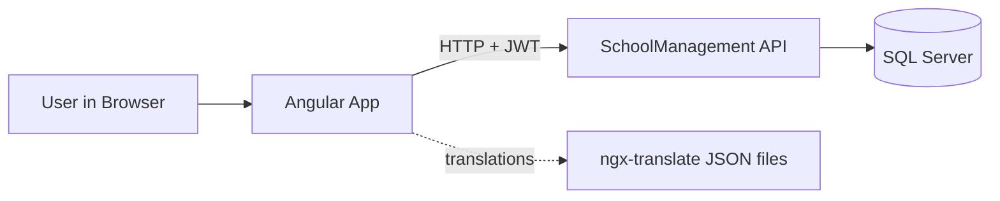

# SchoolManagement UI

An Angular frontend for the [SchoolManagement API](https://github.com/marslanakram/SchoolManagement). It gives school staff a web interface to manage students, teachers, classes, subjects, enrollments, attendance, grades, and school events, backed by a JWT-secured ASP.NET Core API.

---

## 1. Overview

SchoolManagement UI is a single-page application built with **Angular 16** and **Bootstrap 5**. It talks to the SchoolManagement REST API over HTTP, authenticates users with JWT tokens, and supports multiple languages through `ngx-translate`.

---

## 2. Features

- **Single-page application** with client-side routing
- **JWT-based authentication**, with token decoding on the client using `jwt-decode`
- **Multi-language support** (i18n) powered by `@ngx-translate`, with translation files loaded over HTTP
- **Responsive layout** built on Bootstrap 5
- **Icon support** through `iconify-icon`
- **Reactive forms** for data entry and validation
- **Unit-test setup** with Jasmine and Karma

---

## 3. Tech Stack

| Area | Technology |
|------|------------|
| Framework | Angular 16 |
| Language | TypeScript 5.1 |
| Styling | Bootstrap 5.3 |
| Internationalization | @ngx-translate/core and http-loader |
| Auth helper | jwt-decode |
| Icons | iconify-icon |
| Reactive programming | RxJS 7.8 |
| Testing | Jasmine and Karma |
| Build tooling | Angular CLI 16 |

---

## 4. Architecture

The UI is a client of the SchoolManagement API. Requests carry the JWT issued at login, and the API validates it before returning data.



*Figure 1: How the Angular frontend connects to the backend API.*

---

## 5. Project Structure

```
schoolmanagementui/
├── .vscode/            # Editor settings
├── src/                # Application source (components, services, assets)
├── angular.json        # Angular CLI workspace configuration
├── package.json        # Dependencies and npm scripts
├── tsconfig.json       # TypeScript configuration
├── tsconfig.app.json   # App-specific TypeScript settings
└── tsconfig.spec.json  # Test-specific TypeScript settings
```

---

## 6. Getting Started

### 6.1 Prerequisites

- [Node.js](https://nodejs.org/) 16.14+ or 18+ (Angular 16 requirement)
- npm (included with Node.js)
- Angular CLI: `npm install -g @angular/cli@16`
- The [SchoolManagement API](https://github.com/marslanakram/SchoolManagement) running locally or deployed

### 6.2 Clone the Repository

```bash
git clone https://github.com/marslanakram/schoolmanagementui.git
cd schoolmanagementui
```

### 6.3 Install Dependencies

```bash
npm install
```

### 6.4 Point the App to Your API

Set the backend base URL to your running API (for example `https://localhost:<api-port>`). Check the environment or API service files under `src/` for where the base URL is defined, and make sure the API's CORS policy allows your frontend origin.

### 6.5 Run the Development Server

```bash
npm start
```

Open `http://localhost:4200/`. The app reloads automatically when you change source files.

---

## 7. Available Scripts

| Command | Description |
|---------|-------------|
| `npm start` | Start the development server (`ng serve`) |
| `npm run build` | Create a production build in `dist/` |
| `npm run watch` | Rebuild automatically in development mode |
| `npm test` | Run unit tests with Karma |

---

## 8. Authentication Flow

1. The user signs in with their credentials.
2. The API returns a JWT.
3. The app stores the token and decodes it with `jwt-decode` to read user details.
4. Each API request sends the token in the `Authorization: Bearer <token>` header.
5. When the token expires, the user must sign in again.

---

## 9. Internationalization

Language files are loaded at runtime through `@ngx-translate/http-loader`. To add a language, create a new translation JSON file in the assets translation folder and register the language code in the app's translate configuration.

---

## 10. Build for Production

```bash
npm run build
```

The compiled files are generated in the `dist/` folder and can be hosted on any static web server (Nginx, IIS, Netlify, Vercel, and so on). Remember to configure the production API URL before building.

---

## 11. Roadmap

- Role-based screens (Admin, Teacher, Student, Parent)
- Dashboard with attendance and grade summaries
- Right-to-left layout support for Urdu
- Route guards and an HTTP interceptor for automatic token handling
- End-to-end tests and CI/CD pipeline
- Upgrade to the latest Angular version

---

## 12. Contributing

Contributions are welcome. Fork the repository, create a feature branch, commit your changes, and open a pull request.

---

## 13. Author

**Muhammad Arslan Akram** — [@marslanakram](https://github.com/marslanakram)
